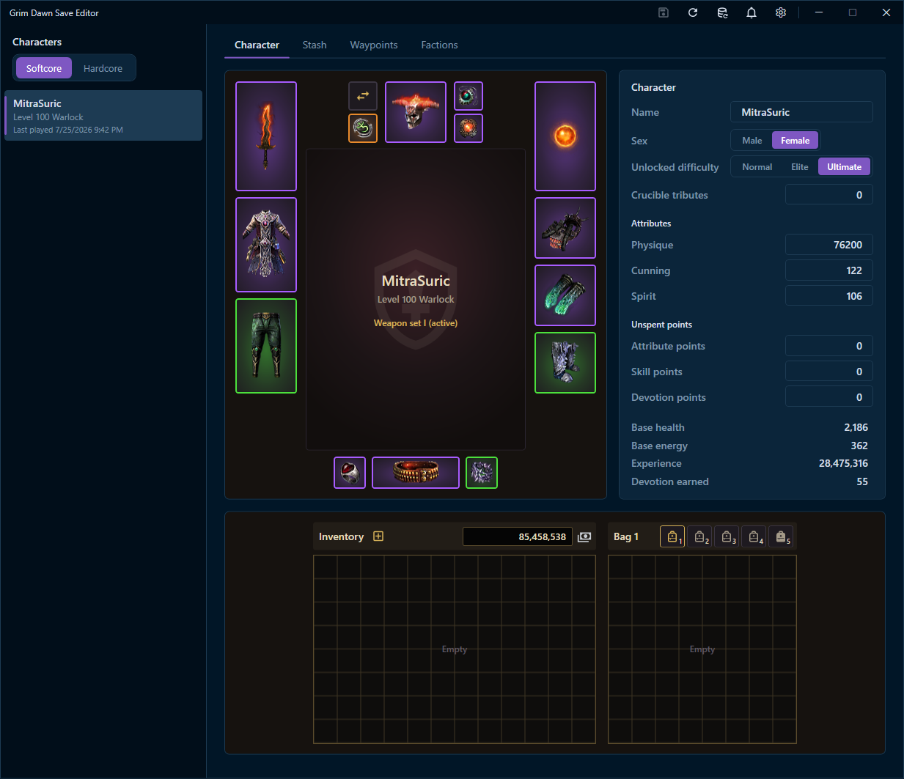
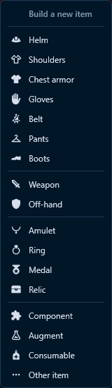
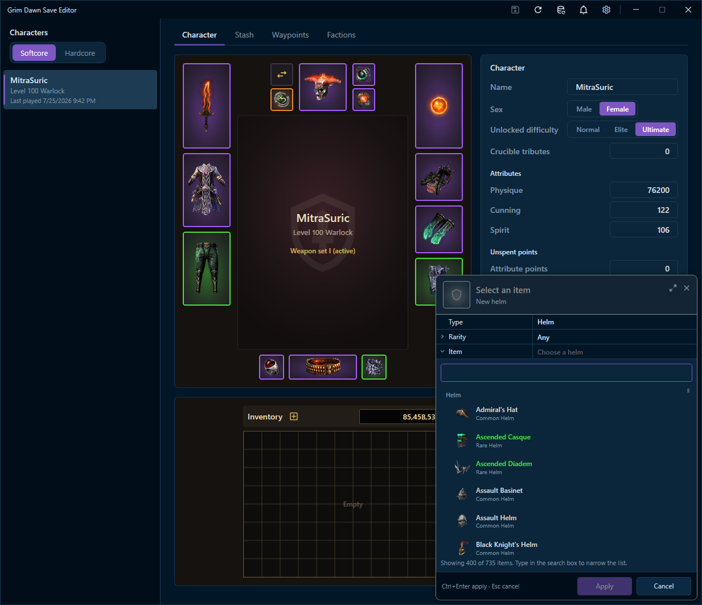
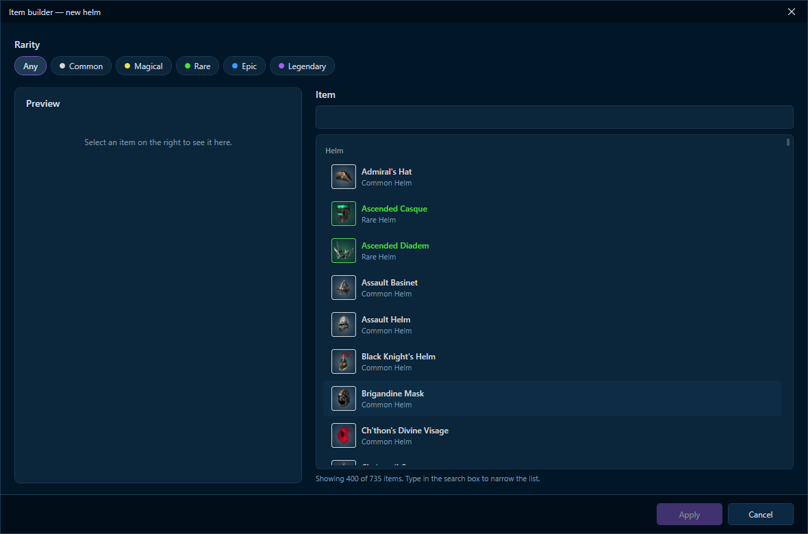
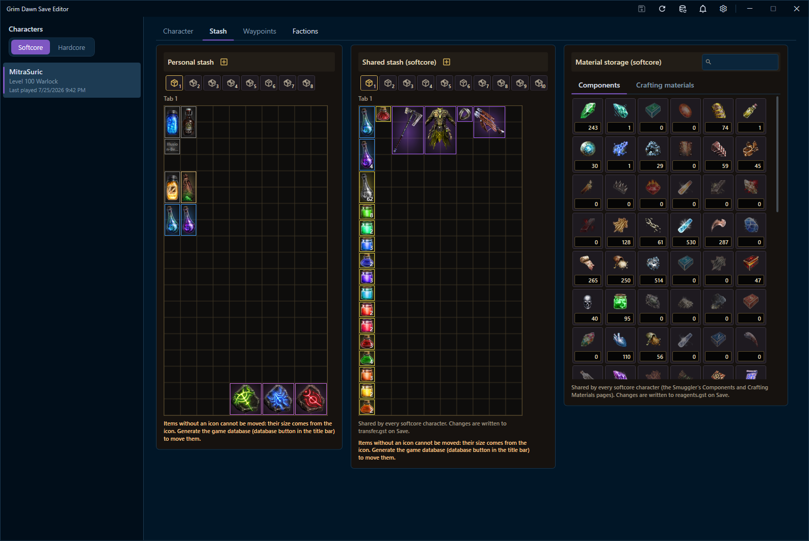
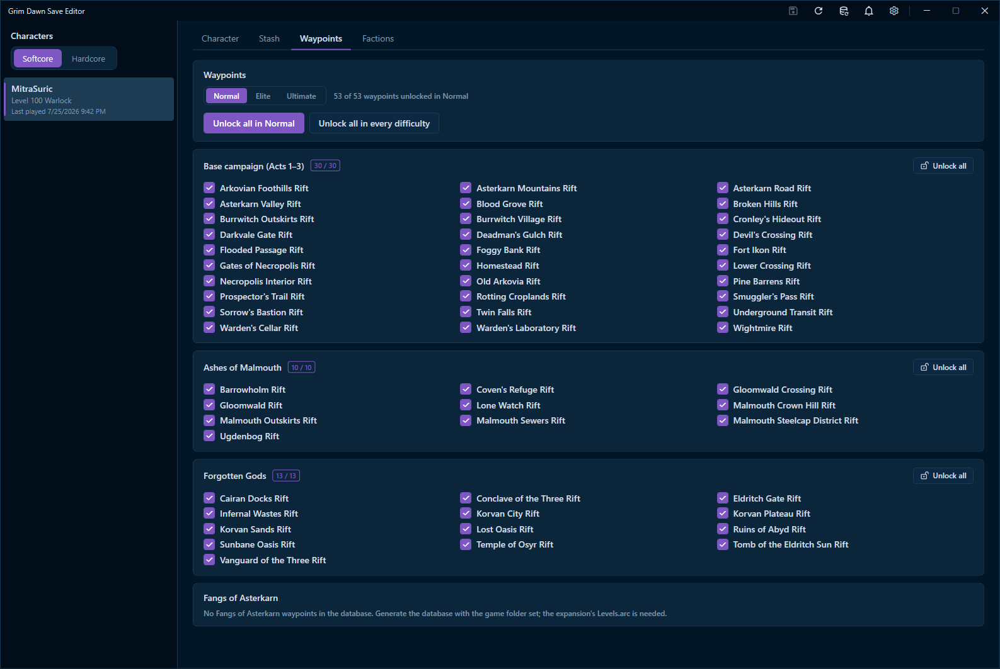
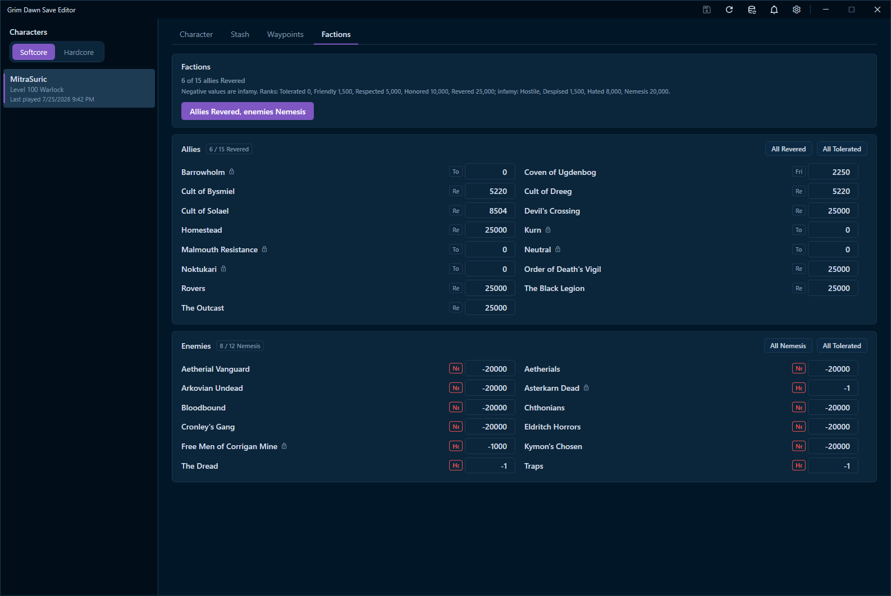

# Grim Dawn Save Editor

[](https://github.com/IgorBabayan/gd-save-editor)
[](https://dotnet.microsoft.com/)
[](https://github.com/IgorBabayan/gd-save-editor/releases/latest)
[](LICENSE)

A modern, visual save editor for **[Grim Dawn](https://www.grimdawn.com/)** offline characters, built with **C#, WPF, and .NET 10**.

Edit character attributes, equipment, inventory, personal and shared stashes, crafting materials, waypoints, and faction reputation in a dark, game-inspired Windows interface. The UI follows the style of my [Last Epoch Save Editor](https://github.com/IgorBabayan/le-save-editor).

**[Download the latest Windows release](https://github.com/IgorBabayan/gd-save-editor/releases/latest)** · **[Report an issue](https://github.com/IgorBabayan/gd-save-editor/issues)**

> [!IMPORTANT]
> **Exit Grim Dawn before saving changes.** The game can overwrite externally modified saves when it exits. The editor creates timestamped backups of files it writes, but you should also keep a separate backup of your save directory, especially when using Steam Cloud.



## Features

### Character editor

- Browse **Softcore** and **Hardcore** characters, with an option to show only self-found (SSF) characters.
- View the character's equipped gear, level, class, experience, base health, base energy, and devotion earned.
- Change **name**, **sex**, and the highest **unlocked difficulty** (Normal / Elite / Ultimate).
- Edit **Physique**, **Cunning**, **Spirit**, **Crucible tributes**, and inventory iron bits.
- Adjust unspent **attribute**, **skill**, and **devotion** points (up to the game's 55-point devotion limit).
- See changed values highlighted before saving; revert edits with **Esc** or the relevant undo control.

### Inventory, equipment and item builder

- Work with equipped items and inventory bags through visual, grid-based item slots.
- **Drag and drop** items between cells and bags, or change and remove items from their context menu.
- Right-click an empty inventory cell to **Build a new item**, or use a bag's **+** button to add an item to the first available space.
- Browse and search items by **category** and **rarity**, including weapons, armor, jewelry, relics, components, augments, and consumables.
- Preview items using their in-game icons and tooltips before applying changes.
- Customize supported item properties such as **prefix**, **suffix**, **crafting bonus**, **component**, **augment**, **relic completion bonus**, **roll seed**, and **stack size**.

<details>
<summary><strong>View item creation screenshots</strong></summary>

**Choose an item category**



**Search and select an item**



**Full item builder**



</details>

### Personal stash, shared stash and material storage

- Edit the selected character's **personal stash** (up to eight purchased tabs).
- Manage the **shared transfer stash** for Softcore or Hardcore characters independently.
- Drag, add, modify, and remove items in stash grids, just like in the inventory.
- Edit shared **Components** and **Crafting materials** in the Smuggler's material storage (Grim Dawn 1.3+).
- Search materials and set their quantities, including materials with a current amount of zero.
- Undo unsaved changes separately for the character's inventory and each stash.

Shared stash and material storage changes affect the other characters using the same Softcore or Hardcore storage.



### Waypoint editor

- Manage rift gates separately for **Normal**, **Elite**, and **Ultimate**.
- Toggle individual waypoints or unlock an entire campaign with one click.
- Unlock every available waypoint in the current difficulty or **all difficulties**.
- Covers the base campaign and supported expansions: **Ashes of Malmouth**, **Forgotten Gods**, and **Fangs of Asterkarn**.

> [!NOTE]
> Waypoint availability depends on the game database and installed expansion files. The editor needs the corresponding `Levels.arc` archives from your Grim Dawn installation to discover expansion rift gates.



### Faction reputation editor

- View factions as **Allies** and **Enemies**.
- Edit reputation/infamy values individually (from **-25,000** to **25,000**).
- Set a faction's rank directly, or apply group actions such as **All Revered**, **All Nemesis**, or **All Tolerated**.
- Use the **Allies Revered, enemies Nemesis** preset to update both groups at once.



### Additional conveniences

- **Save** (`Ctrl+S`) and **Reload** (`F5`) from the title bar.
- **Automatic timestamped backups** of modified character, shared-stash, and material-storage files.
- **Game database generator** for item names, icons, tooltips, categories, and waypoint data.
- **Notification center** with history retained between sessions.
- **Settings** for theme, save directory, Grim Dawn installation directory, and update behavior.
- **Automatic updates** for installer-based installations, with an option to disable or manually check for updates. Unpacked and development builds do not auto-update.

## Installation

### Windows installer (recommended)

1. Open **[GitHub Releases](https://github.com/IgorBabayan/gd-save-editor/releases/latest)**.
2. Download the Windows installer from the latest release's **Assets** section.
3. Run the installer, then open **Grim Dawn Save Editor**.
4. Select your character in the sidebar. If necessary, set the save directory under **Settings**.
5. Generate the **game database** using the database button in the title bar. Set your Grim Dawn installation directory in **Settings** if prompted or if some game data is missing.

> [!TIP]
> You only need the **.NET 10 SDK** if you want to build the application from source. The installer is the recommended way to use released builds.

### Build from source

**Requirements:** Windows and the [.NET 10 SDK](https://dotnet.microsoft.com/download/dotnet/10.0).

```powershell
git clone https://github.com/IgorBabayan/gd-save-editor.git
cd gd-save-editor
dotnet build GD.SaveEditor/GD.SaveEditor.sln
```

The main application is a **Windows Presentation Foundation (WPF)** project, so Windows is required to run the GUI.

## How to use

1. **Close Grim Dawn** and make a copy of your existing save folder.
2. Launch the editor and select a **Softcore** or **Hardcore** character.
3. Open the **Character**, **Stash**, **Waypoints**, or **Factions** tab.
4. Make your changes. When working with items, generate the game database first for accurate icons, item data, and dimensions.
5. Press **`Ctrl+S`** (or click **Save**) to write the changed data.
6. Start Grim Dawn and check the result in-game.

### Save file locations

The editor's default local save path is:

```text
%USERPROFILE%\Documents\My Games\Grim Dawn\save\main
```

Typical local character save:

```text
Documents\My Games\Grim Dawn\save\main\_CharacterName\player.gdc
```

With Steam Cloud enabled, your save files may instead be in a Steam userdata directory, such as:

```text
<Steam folder>\userdata\<Steam user ID>\219990\remote\save
```

The active location depends on your Grim Dawn and Steam configuration. Use **Settings** to select the correct save folder if the editor doesn't show your characters.

| Data | Save file |
| --- | --- |
| Character, equipment, inventory, personal stash | `player.gdc` |
| Shared Softcore stash | `transfer.gst` |
| Shared Hardcore stash | `transfer.gsh` |
| Shared Softcore material storage | `reagents.gst` |
| Shared Hardcore material storage | `reagents.gsh` |

Shared storage files are stored in the `save` directory above the local `save\main` directory. Files written by the editor are backed up using names such as `player.gdc.<date>.bak` and `transfer.gst.<date>.bak`.

> [!WARNING]
> **Steam Cloud:** After changing local save files, Steam may report a synchronization conflict. Carefully choose the version containing your edited changes, and keep backups of the original files until you have verified the result in-game.

## Game database

The editor builds and maintains its local item/game database at:

```text
%APPDATA%\GD.SaveEditor\database.db
```

It uses Grim Dawn game archives to obtain item records, names, icons, and waypoint information:

| Archive | Purpose |
| --- | --- |
| `database/database.arz` | Base-game records and items |
| `gdx1/database/GDX1.arz` | Ashes of Malmouth data |
| `gdx2/database/GDX2.arz` | Forgotten Gods data |
| `gdx3/database/GDX3.arz` | Fangs of Asterkarn data |
| `resources/Text_EN.arc` | English item names and descriptions |
| `resources/Items.arc` | Item icons and related resources |
| `resources/Levels.arc` and expansion `Levels.arc` archives | Campaign maps and rift gates |

For supported archives, the generator first tries `grimtools.com` and falls back to files in your Grim Dawn installation when the downloaded data is not valid. **`Levels.arc` files must be read locally** from the game installation. Missing expansions are skipped.

Database changes are applied incrementally using SQL migrations under:

```text
%APPDATA%\GD.SaveEditor\Migrations
```

If the relevant game records haven't changed, no new migration is created. **Regenerate the database after game updates or installing expansions** if content is missing or out of date.

## Safety notes

- Only edit **offline** characters and save data you own.
- Never modify save files while a character is loaded in Grim Dawn.
- Back up **both character and shared storage** files before making large changes.
- Keep the game database current if an item is missing its icon or cannot be moved correctly in a grid.
- Use the editor's undo controls to discard unsaved edits; restore a backup to undo a change that was already written to disk.

## Project information

- **Source code:** [IgorBabayan/gd-save-editor](https://github.com/IgorBabayan/gd-save-editor)
- **Related project:** [Last Epoch Save Editor](https://github.com/IgorBabayan/le-save-editor)
- **License:** [MIT](LICENSE)
- **Issues and feedback:** [GitHub Issues](https://github.com/IgorBabayan/gd-save-editor/issues)

**Disclaimer:** This is an independent fan-made utility and is not affiliated with or endorsed by **Crate Entertainment**. *Grim Dawn* and its related names, artwork, and game assets belong to their respective owners. Use the editor at your own risk.
